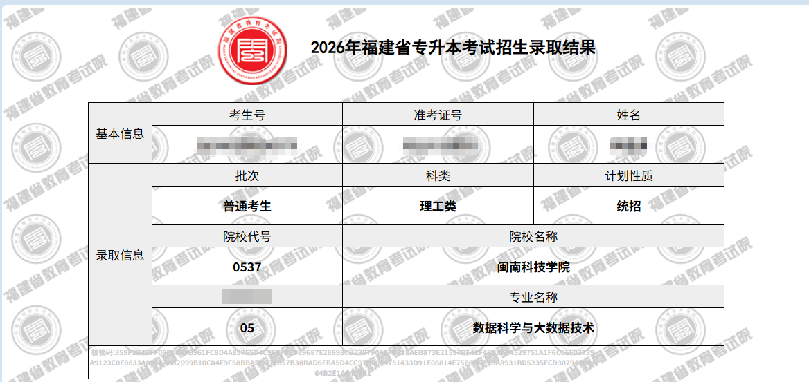

# 📘 闽南科技学院 · 数据科学与大数据技术

`Python` `Git` `Markdown`

---

## 📂 仓库结构

```
mnkjxy/
├── README.md  CHANGELOG.md  git-cheatsheet.md
├── python-learning-plan.md  requirements.txt  .gitignore
├── images/             梦开始的地方.png
├── crawler_douban/     爬虫脚本 + demo 网页
├── Homework/           【新增】按语言归档
│   ├── C/              6 个 lab，32 个 .cpp
│   ├── Data_Structure/ 6 个 lab，17 个 .cpp
│   ├── Java/           6 个 lab（lab1/2/4/5/6）
│   └── Python/         6 个 .ipynb
└── Python_syntax/      7 天练习，8 个 .py

```

## 🛠️ 使用到的工具和技术

| 类别 | 工具 |
|------|------|
| 版本控制 | Git + GitHub |
| 笔记 | Markdown |
| 编程 | Python |

---

## 📄 License

MIT

---

> 🌱 种一棵树最好的时间是十年前，其次是现在。
